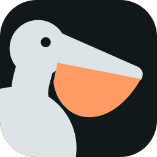
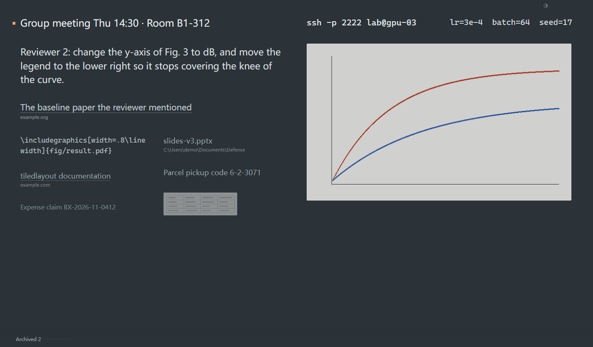
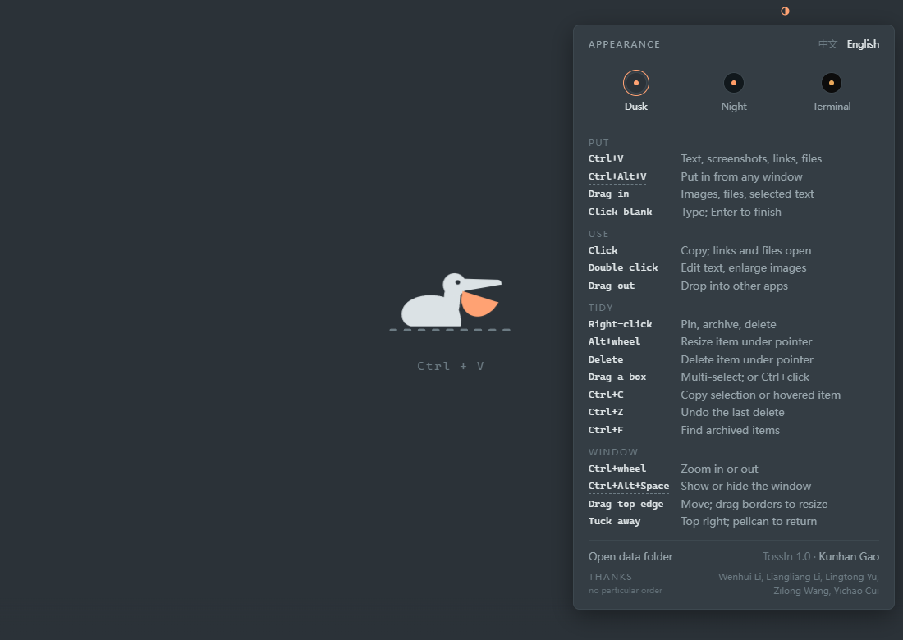

<p align="center"></p>

<h1 align="center">TossIn</h1>

<p align="center"><b>English</b> · <a href="README.md">简体中文</a></p>

https://github.com/user-attachments/assets/ec9f6328-e2c1-4260-9986-deaf18d2079f

<p align="center">A temporary desktop workspace for the work at hand.</p>



TossIn gathers the text, screenshots, links and files you need for your current work on one board. Keep it on a second monitor or at the edge of your screen, and glance at, compare, copy or open things as you need them, without filing away something you will only use for a short while.

## Why

While you work, there are always things you need to keep within reach for a while: a command you keep reusing, a screenshot you compare against, a few pages you go back and forth between, files you are about to drag into another program.

They may not be worth keeping for long, but for now they need to be easy to get at. Put them in a folder and you keep opening it to look for them. Send them to a chat with yourself and new messages soon push them out of sight. Leave them spread across windows and tabs and you keep switching.

TossIn is made for that stretch of temporary use. You do not have to decide which category something belongs to first, or turn everything into a note. Put it within reach, carry on working, and find it when you need it.

## What it does

- **Different materials, side by side.** Text, screenshots, links and files all go on the same board, so you can look at them and compare them together.
- **Put things in without breaking your flow.** Paste with `Ctrl+V`, drag things in, or click an empty spot and type. You can also press a global shortcut from any other window, without switching to the board.
- **Use things directly.** Click text or an image to copy it, click a link or a file to open it, or drag an item into another program.
- **No categories to set up.** No folders or tags. Pin what matters; the rest changes how it is shown as you use it. Items left unused are archived automatically after about eight days, and can still be brought back while they are kept.

## Install

TossIn is currently available for Windows (Windows 10 or 11, 64-bit). A macOS version is planned.

Download the latest version from the [Releases page](https://github.com/Kunhan-Gao/TossIn/releases). Pick either one:

- **Installer**, `TossIn-Setup-x.y.z.exe`: run it, and a TossIn icon appears on the desktop and in the Start menu. It does not need administrator rights. To update later, install the new version over the old one; what is on your board is kept.
- **Portable**, `TossIn-x.y.z-win-x64.zip`: unzip it anywhere and run `TossIn.exe` inside.

The app is not code-signed, so the first time you run it the system may show "Windows protected your PC". Choose **More info**, then **Run anyway**.

To uninstall the installed version, find TossIn under **Apps** in Windows Settings and choose Uninstall. It asks whether to also delete what is on your board and your settings; by default they are kept.

On first launch the board opens on your second monitor if you have one, otherwise as a strip along the right edge of the screen. Move and resize it however you like; it remembers.

## How to use it

Click the pelican on an empty board, or the half-circle button at the top right, to see this list inside the app.

| | |
|---|---|
| **Put** | |
| `Ctrl+V` | Put in whatever is on the clipboard: text, a screenshot, a link, files |
| `Ctrl+Alt+V` | Do the same from any window, without switching to the board |
| Drag in | Images, files, selected text |
| Click blank space | Type directly; `Enter` to finish |
| **Use** | |
| Click | Copy the item; links and files open instead |
| Double-click | Edit text, or enlarge an image |
| Drag out | Drop the item into another program |
| **Tidy** | |
| Right-click | Pin, archive, delete |
| `Alt`+wheel | Make the item under the pointer larger or smaller; right-click to reset its size |
| `Delete` | Delete the item under the pointer |
| Drag a box | Select several items; `Ctrl`+click adds one at a time |
| `Ctrl+C` | Copy the selected items, or the item under the pointer when nothing is selected |
| `Ctrl+Z` | Undo the last delete (for a few seconds) |
| `Ctrl+F` | Search the archive; also reachable from the bottom-left corner |
| **Window** | |
| `Ctrl`+wheel | Make everything larger or smaller |
| `Ctrl+Alt+Space` | Show or hide the window |
| Drag the top edge | Move the window; drag its borders to resize |
| Top-right button | Tuck the board against the screen edge |

The two global shortcuts can be changed. Open the panel, click the shortcut, and press the new combination. One key does one thing: a combination is refused, with the reason shown, if it repeats the other global shortcut, takes a key the board already uses (such as `Ctrl+V`), or is common in other programs (such as `Ctrl+S`). If another program is already using a shortcut, a dot appears on the top-right button and the panel marks it so you can pick a different one.

The tray icon's menu has **Always on top**, **Start with Windows**, **Open data folder** and **Quit**.



### A few details

- **Copying several items.** `Ctrl+C` on a selection: if every selected item is an image or a file, the files themselves are copied, so you can paste them into a chat window or a folder. Otherwise the text is copied, one item per line.
- **Long screenshots.** A very long screenshot is not shrunk to fit. The board shows only its top part; double-click it to scroll through the whole image.
- **Putting in something twice.** Putting in an item that is already on the board does not create a copy. The existing item comes back to the top.
- **Knowing it was caught.** When you use the global shortcut while the board is hidden or covered by other windows, a small pelican pops up in the corner of the screen, opens its beak, and is gone a second later.

## Tucking it away

If you have one screen and do not want the board taking up space all the time, tuck it against the screen edge. A small pelican stays there, peeking in.

- **Tuck**: move the pointer to the top of the board and click the "Tuck to screen edge" button at the top right.
- **Bring back**: click the pelican. The board comes back and stays until you click that button again. The show/hide shortcut works too.
- **Or open on hover**: in the panel, switch "Edge pelican" to "Hover". The board then comes out when the pointer rests on the pelican, and tucks itself back once the pointer leaves the board.
- **Put something in**: drag it onto the pelican. The board comes out just to catch it and tucks back in once the pointer leaves.
- **Move the pelican**: drag it up or down to get it out of your way.
- If you use the global shortcut while the board is tucked away, the pelican at the edge opens its beak.
- While another program is full screen (a video, a slideshow), the pelican hides and returns when it ends.

## How the display changes with use

Each item has a freshness that halves every two days. Using an item (copying, opening or editing it) resets it to fresh, and each use makes it last half a day longer, up to a week. Size, brightness and position on the board all follow freshness.

- **Never used**: archived after about eight days.
- **Pinned**: stays fresh until you unpin it.
- **Archived**: kept for 30 days, then deleted. Each archived item shows how many days it has left. Until then, search the archive and click an item to bring it back.

## Appearance and language

Three dark looks: **Dusk** (the default), **Night** and **Terminal**. The interface is available in English and Simplified Chinese. Both are switched in the panel.

## Privacy and network use

TossIn has no account and no telemetry, and it never uploads what you put on the board. It connects to the internet in exactly three cases:

- **You put in a link.** The app requests that page once to read its title.
- **You drag in an image from a web browser.** The app downloads that image so it can keep a copy.
- **Update check.** Shortly after starting, and every 12 hours after that, the app asks GitHub for the latest release number of this repository. If there is a newer version, the panel shows a download link. It does not download or install anything by itself.

## Where your data lives

Everything is stored on your own computer. On Windows that is `%APPDATA%\TossIn\data`:

- `index.json` holds the items.
- `images\` holds the pictures you put in, as ordinary image files.

Files you put in are not copied; the board only remembers where they are. Use **Open data folder** in the panel or the tray menu to get there.

## Build from source

You need Node.js 22.12 or newer.

```
npm install
npm start
```

The first `npm start` downloads the Electron runtime (about 150 MB). To build a runnable Windows folder in `dist\`:

```
npm run pack
```

To turn that into an installer and a portable zip:

```
npm run installer
```

The installer step needs [NSIS](https://nsis.sourceforge.io/): unzip its portable build into `dev\tools\nsis\`, or install it system-wide.

The demo video is generated by a script too: the picture is the real interface rendered frame by frame from a storyboard, and the sound is synthesized. The results land in `dist\video\`.

```
npm run video
```

## Good to know

- TossIn is built on Electron. It takes roughly 350 MB on disk and about 175 MB of memory while running, almost all of it the bundled browser engine.
- The icon is a pelican because its pouch is where it keeps things for now.

## Thanks

Thanks to these friends for their support (in no particular order):

Wenhui Li, Liangliang Li, Lingtong Yu, Zilong Wang, Yichao Cui

## Author

Made by [Kunhan Gao](https://github.com/Kunhan-Gao).

## License

[MIT](LICENSE)
