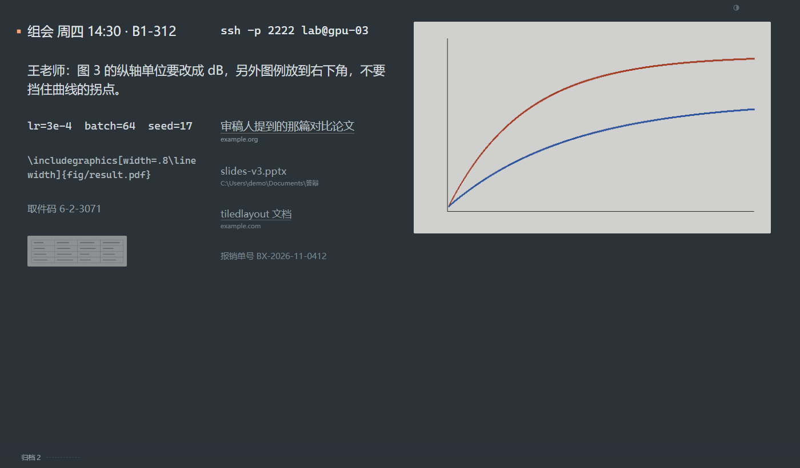
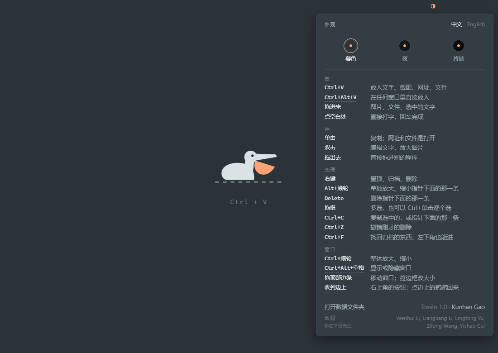

<p align="center"></p>

<h1 align="center">先放这儿</h1>

<p align="center">TossIn：为手头工作准备的桌面临时工作区。</p>

<p align="center"><a href="README.md">English</a> · <b>简体中文</b></p>



“先放这儿”把当前工作临时要用的文字、截图、链接和文件集中在一块看板上。摆在副屏，或贴在屏幕边上，需要时随手查看、对照、复制或打开，不必为了短期使用而专门归类保存。

## 为什么做这个

工作时，总有一些东西需要暂时放在手边：一条反复使用的命令、一张用来对照的截图、几个来回查看的网页，还有准备拖进其他程序的文件。

它们不一定值得长期收藏，却需要在眼下这段时间里方便取用。放进文件夹，要来回打开查找；发给自己的聊天窗口，很快就被新消息顶走；散在不同窗口和标签页里，又需要不断切换。

“先放这儿”就是为这段临时使用的过程准备的：不用先想放在哪个分类，也不用把所有东西都变成笔记。先放到手边，继续做事，需要时就能找到。

## 它能做什么

- **不同材料，放在一起。** 文字、截图、链接和文件都能放到同一块看板上，方便同时查看和对照。
- **随手放，不打断工作。** 按 `Ctrl+V` 粘贴、直接拖入，或点空白处打字；也可以在其他窗口按全局快捷键，不用切换到看板。
- **需要时，直接取用。** 单击文字或图片即可复制，单击链接或文件即可打开，也可以把材料拖进其他程序。
- **不必建立分类。** 不需要文件夹或标签。重要的内容可以置顶，其余内容会随使用情况调整显示；持续未用的内容约八天后自动归档，归档后仍可在保留期内找回。


## 安装

目前提供 Windows 版（64 位的 Windows 10 或 11），macOS 版在计划中。

到 [Releases 页面](https://github.com/Kunhan-Gao/TossIn/releases) 下载最新版本，两种任选：

- **安装版** `TossIn-Setup-x.y.z.exe`：双击安装，桌面和开始菜单里会多一个“先放这儿”的图标。不需要管理员权限。以后装新版本直接覆盖安装，看板上的内容不受影响。
- **免安装版** `TossIn-x.y.z-win-x64.zip`：解压到任意位置，运行里面的 `TossIn.exe`。

程序没有数字签名，第一次运行时系统可能提示“Windows 已保护你的电脑”。点 **更多信息**，再点 **仍要运行**。

卸载安装版：在系统设置的“应用”里找到 TossIn，点卸载。卸载时会问要不要一并删除看板上的内容和设置，默认保留。

第一次启动时，有副屏就铺在副屏上，没有就在屏幕右侧占一条。之后随意移动、缩放，它会记住。

## 怎么用

点空看板上的鹈鹕，或者右上角的半圆按钮，可以在软件里看到这张表。

| | |
|---|---|
| **放** | |
| `Ctrl+V` | 放入剪贴板里的内容：文字、截图、网址、文件 |
| `Ctrl+Alt+V` | 在任何窗口里直接放入，不用切到看板 |
| 拖进来 | 图片、文件、选中的文字 |
| 点空白处 | 直接打字，回车完成 |
| **用** | |
| 单击 | 复制；网址和文件是打开 |
| 双击 | 编辑文字，放大图片 |
| 拖出去 | 直接拖进别的程序 |
| **整理** | |
| 右键 | 置顶、归档、删除 |
| `Alt`+滚轮 | 单独放大、缩小指针下面的那一条；右键可以恢复大小 |
| `Delete` | 删除指针下面的那一条 |
| 拖框 | 多选；`Ctrl`+单击可以逐个加选 |
| `Ctrl+C` | 复制选中的几条；没有选中时复制指针下面的那一条 |
| `Ctrl+Z` | 撤销刚才的删除（几秒内有效） |
| `Ctrl+F` | 搜索归档；左下角也能进 |
| **窗口** | |
| `Ctrl`+滚轮 | 整体放大、缩小 |
| `Ctrl+Alt+空格` | 显示或隐藏窗口 |
| 拖顶部边缘 | 移动窗口；拉边框改大小 |
| 右上角的按钮 | 把看板收到屏幕边上；点边上的鹈鹕回来 |

两个全局快捷键可以改：打开面板，点一下那个快捷键，再按下新的组合。如果某个快捷键被别的程序占用了，面板里会标出来，换一个就行。

托盘图标的右键菜单里有 **窗口总在最前**、**开机自启**、**打开数据文件夹** 和 **退出**。



### 几个细节

- **一起复制。** 多选后按 `Ctrl+C`：选的全是图片或文件时，复制的是这些文件本身，可以直接粘贴到聊天窗口或文件夹里；其余情况复制的是文字，每条占一行。
- **长截图。** 很长的截图不会被整体缩小，看板上只露出顶部一段，双击后可以上下滚动着看全图。
- **重复放入。** 把看板上已经有的内容再放一次，不会多出一份，原来那条会回到最前面。
- **放入时的反馈。** 用全局快捷键放入时，如果看板被隐藏或者被别的窗口挡住了，屏幕右下角会冒出一只小鹈鹕，张一下嘴，一秒后消失。看到它，就知道接住了。

## 收到屏幕边上

只有一块屏幕、不想让看板一直占着地方时，可以把它收到屏幕边上，只留一只探出头的小鹈鹕。

- **收**：指针移到看板顶部，点右上角的“收到屏幕边上”按钮。
- **回来**：点一下边上的鹈鹕，看板回来并一直留着，直到你再点那个按钮。显示/隐藏的快捷键也可以。
- **放入**：拖着内容移到鹈鹕上，看板会临时出来接一下，指针离开后自己收回去。
- **挪位置**：按住鹈鹕上下拖，挪到不碍事的地方。
- 看板收着的时候用全局快捷键放入，边上的鹈鹕会张一下嘴。
- 别的程序全屏时（看视频、放幻灯片），鹈鹕会自己躲起来，退出全屏再出现。

## 显示如何随使用变化

每一条有一个“新鲜度”，每两天减半。用一次（复制、打开或编辑）就恢复到最新鲜，而且每用一次能多留半天，最多一周。大小、明暗和在看板上的位置都跟着新鲜度走。

- **一直没用过**：大约八天后归档。
- **置顶**：一直保持最新鲜，直到取消置顶。
- **已归档**：保留 30 天，之后删除。归档里每一条都标着还剩几天，在那之前可以搜索，点一下就捞回来。

## 外观和语言

三种深色外观：**暮色**（默认）、**夜**、**终端**。界面有简体中文和英文。两者都在面板里切换。

## 隐私和联网

“先放这儿”没有账号，不收集使用数据，也不会上传你放在看板上的任何内容。它只在下面三种情况下联网：

- **放入一个网址时。** 程序会访问一次那个网页，读取它的标题。
- **从浏览器拖入一张图片时。** 程序会下载那张图片，保存一份。
- **检查新版本。** 启动后不久、之后每 12 小时，程序会向 GitHub 询问本仓库最新的版本号。有新版本时，面板里会出现下载入口。程序不会自己下载或安装任何东西。

## 数据放在哪

全部存在本机。Windows 上是 `%APPDATA%\TossIn\data`：

- `index.json` 是所有条目。
- `images\` 是你放进来的图片，都是普通的图片文件。

放进来的文件不会被复制，看板只记住它在哪。面板或托盘菜单里的 **打开数据文件夹** 可以直接到这里。

## 从源码构建

需要 Node.js 22.12 或更新的版本。

```
npm install
npm start
```

第一次 `npm start` 会下载 Electron 运行环境（约 150 MB）。要在 `dist\` 里生成 Windows 版的可运行文件夹：

```
npm run pack
```

再做成安装包和免安装压缩包：

```
npm run installer
```

做安装包需要 [NSIS](https://nsis.sourceforge.io/)：把它的免安装版（zip）解压到 `dev\tools\nsis\` 下面，或者装到系统里。

演示视频也是脚本生成的：画面是真实界面按分镜逐帧渲染出来的，声音是程序合成的。成片在 `dist\video\` 里。

```
npm run video
```

## 说明

- 程序基于 Electron，占用磁盘约 350 MB，运行时内存约 175 MB，几乎全是自带的浏览器内核。
- 图标是鹈鹕，因为它嘴下面的喉囊，就是它“先放这儿”的地方。

## 致谢

感谢以下朋友的支持（排名不分先后）：

Wenhui Li、Liangliang Li、Lingtong Yu、Zilong Wang、Yichao Cui

## 作者

[Kunhan Gao](https://github.com/Kunhan-Gao)

## 许可

[MIT](LICENSE)
